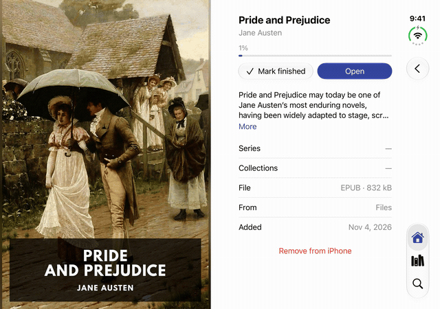
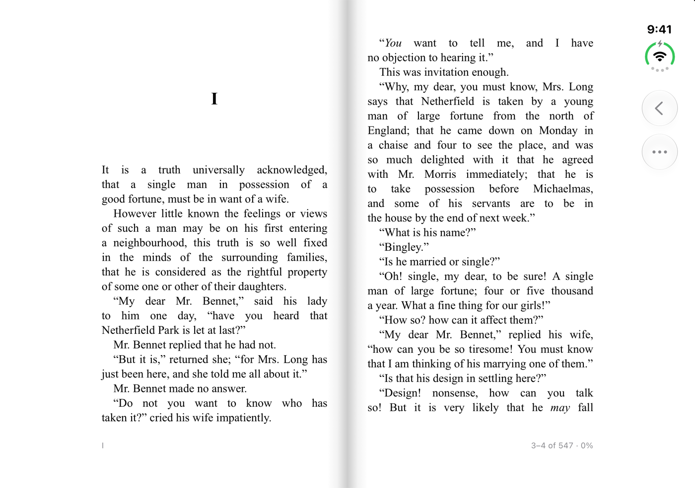
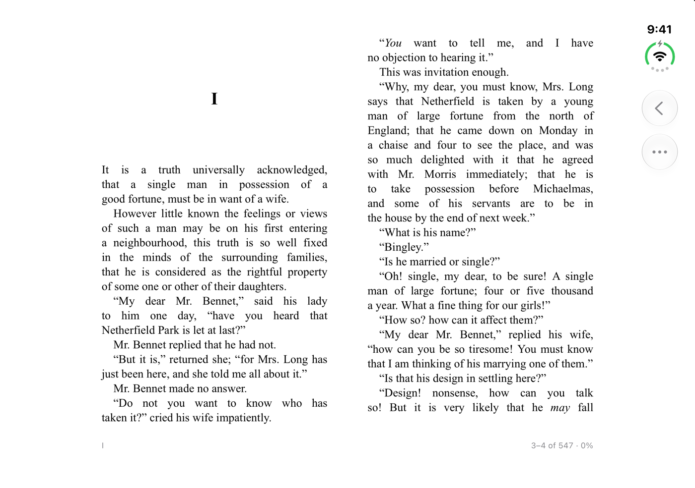

<p align="center">
  
</p>

<h1 align="center">Octavo</h1>

<p align="center">Read the books on your own server, on a phone that opens like a book.</p>

<p align="center">
  
</p>

> **Status:** it works today if you build it yourself. There's no TestFlight or App Store version yet.

Octavo is a free, open-source e-reader built for iPhone Duo. It reads from [BookOrbit](https://github.com/bookorbit/bookorbit), from any OPDS catalog, and from files you import. No accounts, no subscriptions, no tracking.

<table>
  <tr>
    <td align="center"><br>Folded: one page</td>
    <td align="center"><br>Half open: a book</td>
    <td align="center"><br>Open: two pages</td>
  </tr>
</table>

## What it does

- **Opens like a book.** One page folded, two pages open, and a real spread with a shadow at the spine when half open. Your place holds as you move between them.
- **Keeps your place.** With BookOrbit, your position matches its web reader exactly, in both directions.
- **Lets you look something up.** Jump to a map or a glossary, then tap "Back to page 312". Your place doesn't move, here or on the server, until you settle somewhere new.
- **Reads your way.** Four themes, fonts, text size, line spacing, margins and page turns. Contents, bookmarks and search in the book, and a scrubber that zooms in to one page at a time.

## Works with

| Where your books are | What you get |
|---|---|
| **BookOrbit** | Your library, with your place and bookmarks synced |
| **OPDS catalogs** | Browse, search and download. Checked against Calibre-Web, COPS, Kavita and Komga |
| **Files** | Import EPUB, MOBI, AZW3 or FB2, or open them in Octavo from another app |

Books and sign-ins stay between your iPhone and your server. Passwords go in the Keychain, plain http only goes to home and VPN addresses, and self-signed certificates work once you trust them.

## Not yet

PDF and comics, highlights and notes, footnotes that open on the page, iCloud and KOReader sync, and more than one server.

## Build it

You'll need Xcode 27.1 and the iOS 27.1 SDK. There are no packages to install.

```bash
git clone https://github.com/jiannazzone/Octavo-OPDS-Reader.git
cd Octavo-OPDS-Reader
open Octavo.xcodeproj
```

Run the `Octavo` scheme on an iPhone Duo or its simulator. You don't need a server to try it: Pride and Prejudice is built in, and a short tour opens it.

To run the tests:

```bash
xcodebuild test -project Octavo.xcodeproj -scheme Octavo \
  -destination 'platform=iOS Simulator,name=iPhone Duo,OS=27.1'
cd Packages/OctavoKit && swift test
```

`dev/` has local BookOrbit and OPDS servers in Docker, and `Scripts/fetch-sample-books.sh` downloads more test books. `CLAUDE.md` explains how the project fits together, `docs/design/direction.md` has the design decisions, and `docs/notes/` has the engineering notes.

## How it's made

I'm using Claude as part of the development process.

Ideas and bug reports are welcome in the [issues](https://github.com/jiannazzone/Octavo-OPDS-Reader/issues).

Octavo reads books with [foliate-js](https://github.com/johnfactotum/foliate-js). It's a separate project from BookOrbit, and talks to it through its API.

## License

Octavo is licensed under the [Mozilla Public License 2.0](LICENSE). Third-party components keep their own licenses: see [THIRD-PARTY-NOTICES.md](THIRD-PARTY-NOTICES.md).
