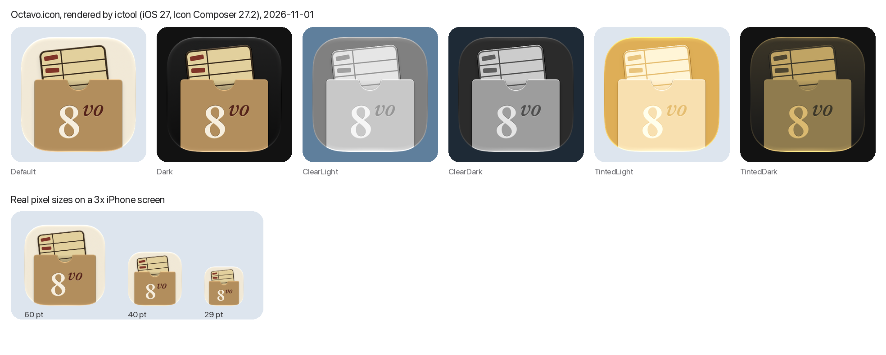

# Octavo logo and app icon

Status: **direction chosen, draft icon built** (logo brainstorm with Adam, 2026-11-01). Everything below marked as a decision was Adam's call. The icon isn't in the app target yet; that's a later step (see Next steps).

- **App icon:** the library book pocket (sketch e3). A checkout card, tilted and half pulled out of a kraft pocket, with **8vo** stamped on the pocket.
- **Glyph (one colour):** the bare **8vo**, for monochrome places such as Settings → About or a Live Activity.

*8vo* is how bibliographers abbreviate *octavo*: a sheet folded three times into 8 leaves. The pocket and card bring in the library: your own books, and a card that records every loan.



## Files

| What | Where |
|---|---|
| Icon Composer file (the draft icon) | `logo/Octavo.icon` |
| Renders from Apple's `ictool` (iOS 27) | `logo/renders/` |
| One-colour glyph, outlined | `logo/glyph-8vo.svg` |
| Sketches of every direction explored | `logo/directions.svg` |
| How e3 was refined at 60 pt | `logo/refinement.svg` |
| Figma page "Logo" (Overview, and Masters: `App icon` component set, `Glyph · 8vo` component) | [Octavo-UX › Logo](https://www.figma.com/design/ElJJ7OtF8LOuX6dc68qZ23/Octavo-UX?node-id=72-2) |

## How we got here

**Feel (decided).** Bookish and warm, crafted and printerly. Not chosen: quiet/system, playful.

**Directions explored** (sketches in `logo/directions.svg`):

| Direction | Takes | Outcome |
|---|---|---|
| 1 · The folded sheet | A imposed sheet (8 panels), B three folds, C the gathering (nested folds end-on) | A and B shortlisted, then dropped in favour of 8vo and the card |
| 2 · The open book | A the spread with a ribbon, B book mode, C page turn | A shortlisted, then dropped. No Duo outline anywhere: the HIG says not to draw Apple hardware |
| 3 · Letterforms | A 8vo, B an O with a ribbon, C a ribbon tied into an 8 | **8vo kept**; it became the glyph and the lettering on the icon |
| 4 · Your own library | A shelf, B catalogue card, C ex-libris bookplate | Shelf dropped as generic. Card and bookplate shortlisted; the card went on to the finalists |
| 5 · 8vo on a catalogue card | d full-bleed card, d1 punch hole only, d2 tabbed guide card, d3 cards in a drawer | The full-bleed card **read as a notepad** (Adam). d3 became a finalist |
| 6 · The library book card (Adam's idea) | e1 card in its pocket, e2 date-due card, e3 pocket front | e1 and e3 finalists; **e3 chosen** |

**Finalists:** 8vo alone, d3 (drawer), e3 (pocket front), e1 (card in pocket), compared in light, dark, tinted and clear and at 29 pt. **Chosen: e3 as the icon, with the bare 8vo as the glyph.** The pocket's notch keeps its outline readable at small sizes, and the 8vo on the pocket matches the glyph.

## Refining the icon at 60 pt (decided, in order)

See `logo/refinement.svg`.

1. **Softer corners** on the card, stamps and pocket.
2. **Card tilted 6° left**, pivoting where it enters the pocket, so it reads as half pulled out. A 3° tilt looked accidental; a lean to the right fought the "vo".
3. **Pocket raised to 37%**, with the **8vo about 20% larger**. At 33% the card shrank to a strip.
4. **Pocket lip: flat** (no painted highlight). A highlight made by subtracting a shifted copy changed thickness around the notch. An even-width lip or a bevel would also work, but Icon Composer already draws a specular edge on every layer, so a painted one would double up.
5. **No baked shadows.** The HIG says to let the system add depth. The one painted shading kept is the **notch shade** on the card, cut to the shape of the notch opening (a rectangle showed through the translucent pocket in Clear).
6. **Six-row card** ending at 74%, with the rules and date column running its full length, so the card looks in proportion behind the clear pocket and its bottom edge shows there.
7. **8vo without Liquid Glass, stamped into the pocket** (Adam set glass off in Icon Composer; the subtle 4 px stamp was chosen over a 7 px one, `logo/renders/stamp-options.png`).

## The icon as built

Measurements are percentages of the 1024 px canvas.

- **Background** (set in Icon Composer, not exported): `#F2E8D5`.
- **Card** (`1 Card.svg`): `#E6CF96`, outline and rules `#3A2A1A` (outline 1.5%, rules 1%), corner radius 4.5%. 56% wide (x 22–78%), top 12%, rules at 24, 34, 44, 54 and 64%, bottom 74%, date column at x 40%. Two stamps `#8B2E23` in the date column of rows 1 and 2 (12 × 4%, turned −4° and +3°). The whole card is turned −6° about (50%, 62%) and raised 2%. The notch shade is a gradient of `#3A2A1A` from 0 to 38% opacity, filling the notch opening.
- **Pocket** (`2 Pocket.svg`): `#B98C55`, x 12–88%, top at 37% to the bottom edge, top corners 3%. The thumb notch is a 9.6% radius arc centred at x 50%, reaching 46.5%.
- **Lettering** (`3 Lettering.svg`): EB Garamond, outlined. "8" Medium at 44% size, centred at x 42%, baseline 88%, `#F7EEDC`. "vo" Medium Italic at 22%, centred at x 63%, baseline 69%, `#5E1F17`.
- **Stamp** (`3a`, `3b`): two copies of the lettering, `#7A5730` moved up 4 px and `#DDBB86` moved down 4 px, behind the letters.

**Icon Composer settings:** iOS only. Three groups, back to front:
- **Card:** translucency off, neutral shadow 50%.
- **Pocket:** translucency off, neutral shadow 50%.
- **Lettering:** layers Lettering, Stamp highlight and Stamp shadow, all with glass off; group shadow 0.

Specular, blur and refraction are at the defaults. Dark, Clear and Tinted are **generated by Icon Composer**; there are no per-appearance overrides yet. The auto-generated Dark keeps the kraft pocket on a dark background and reads well.

**Glyph:** "8vo" in black, EB Garamond Medium and Medium Italic, with a rule under the "vo" (`glyph-8vo.svg`, Figma `Glyph · 8vo`).

**Rendering:** `ictool` ships inside Icon Composer:

```bash
"/Applications/Xcode.app/Contents/Applications/Icon Composer.app/Contents/Executables/ictool" docs/design/logo/Octavo.icon --export-image --output-file out.png --platform iOS --rendition Default --width 60 --height 60 --scale 3
```

Renditions: `Default`, `Dark`, `ClearLight`, `ClearDark`, `TintedLight`, `TintedDark` (tinted needs `--tint-color` and `--tint-strength`, e.g. 0.25 and 0.75).

## Apple's guidance that shaped this

From the HIG [App icons](https://developer.apple.com/design/human-interface-guidelines/app-icons) page and [Creating your app icon using Icon Composer](https://developer.apple.com/documentation/xcode/creating-your-app-icon-using-icon-composer):

- **One artwork for every size.** The system renders all sizes from the single Icon Composer file; there's no per-size artwork. Small sizes are handled by keeping that one design simple: few shapes, no very thin lines.
- **Let the system add effects.** Specular highlights, drop shadows between layers, bevels and blurs come from Liquid Glass. Custom effects are allowed if used deliberately; the stamp is our one.
- **Layers:** at most four groups, clearly defined edges, text as outlines, background colour set in Icon Composer.
- **No Apple hardware** in icons, hence no Duo outline.
- **No fallback icons needed.** The deployment target is iOS 27.1, so Xcode generates no images for older releases, and the iOS 26 previews in Icon Composer don't apply.

## Licensing

The only third-party asset is **EB Garamond** (SIL OFL 1.1), used as outlines. It's credited in `THIRD-PARTY-NOTICES.md`. Nothing comes from BookOrbit or imitates another product's mark.

## Next steps

1. **Small sizes.** At 29 pt the card rules are under a pixel wide and the "vo" is at its limit. Check on a device, then decide whether to thicken or drop rules in the one artwork.
2. **Appearances.** Decide whether the auto-generated Dark, Clear and Tinted are final or need overrides in Icon Composer. The Dark, Tinted and Clear variants in Figma are hand-made simulations from before Icon Composer, superseded by the renders.
3. **The glyph's rule.** The glyph has a rule under "vo" and the icon doesn't. Decide whether they should match.
4. **Keeping Figma and the icon in step.** The Figma Light variant is the source for `1 Card.svg`, `2 Pocket.svg` and `3 Lettering.svg`. The stamp layers are recoloured copies of the lettering, moved ±4 px, and aren't in Figma. Re-export all of them after any Figma change.
5. **Make it the app icon** (needs Adam's OK): add `Octavo.icon` to the app target, which replaces the `AppIcon` asset catalog, and check the App Store icon in App Store Connect.
6. **Re-render when iOS 28 arrives**, since Liquid Glass effects can change between system versions.
