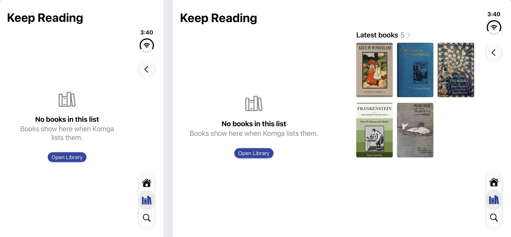

# Empty lists (#30)

A list that came back with nothing in it is an invitation, not a blank screen. Decided with Adam on 2026-11-05 from mockups drawn over real screenshots (decision 22 in `docs/design/direction.md`), and built the same day.

## How it fits together

- **`FeedModel.cameBackEmpty`** picks the screen in `FeedScreen`. It's set when a first page has nothing on it, and stays set through a reload, because `reload()` puts the list in `.loading`: going by the state, pulling down would swap the message for blank covers and back. A reload that fails clears it, so the screen says it couldn't load instead of saying there are no books.
- **`EmptyFeed`** is the screen: one scroll view with the invitation folded, and an `HStack` of the two pages unfolded, as Home's is. The invitation is in a scroll view so the list can still be pulled down, and `containerRelativeFrame(.vertical)` centres it on its page.
- **`EmptyListWording`** has the words, from the list's `LibraryEntry.Kind` and the server's name. An OPDS list is always `.feed`, so a chip like Keep Reading and any other OPDS list say the same thing. Octavo can't tell what such a list is for, and doesn't push places to an OPDS server, so "Start a book and it'll show here" would be untrue.
- **`ShellModel.openLibrary(showing:)`** is the button: the Library's top, on the list's server. The server only changes for a list opened from Search on another server. Search's own screens stay where they were.
- **The right page** is a `LibraryShelf` with `maxRows: 3` and a one-page `Spread` in its environment, so its grid lays out for that page alone. `LibraryView.newest` finds the list by the same `sections` the Library's shelves use, so the heading matches the shelf.

## The hinge

Before this, the message wasn't on the left page at all. `FeedContent` sized everything in its `VStack` to the left page, so with nothing else in it the stack was only that wide, and the scroll view centred it across the spread: "Nothing here yet" ran over the hinge, and "0 books" sat out of line with the title. `FeedContent`'s stack now fills the scroll view and leads, which also puts "Couldn't load this list" on the left page. That one was fixed by reading the layout and wasn't seen on screen, since it takes a server that fails.

This doesn't reach Home's empty screen, which centres `EmptyInvitation` across the spread: a simulator screenshot shows its message across the hinge. On iPhone's reads the same way in its code, but wasn't checked on screen.

## Checked on the simulator

`Octavo Empty Lists` (C7B3116F-8A77-4EAD-9715-F9D4F7D47226), with the local servers.

| What | Result |
|---|---|
| Komga's Keep Reading: folded, flat, half open | As in the picture |
| Kavita's On Deck | "Books show here when Kavita lists them.", Recently Added on the right |
| An empty BookOrbit collection, made for the check and deleted after | The collection's wording, Recently added on the right |
| Komga's All collections, a list of lists | "No books in this list", which is true enough |
| Open Library | The Library's top |
| Open Library on Komga's list, opened from Search with BookOrbit chosen | The Library shows Komga, title "Komga ⌄" |
| A cover, and the heading, on the right page | Open the book's screen and the list, and ‹ comes back |
| A scripted pull down on the empty screen | The message stays, with no blank covers. The request going out wasn't confirmed |

Not seen on screen: the right page left blank (a server with no such list, or that list being the empty one). `aReloadThatFailsIsNoLongerAnEmptyList` covers the reload's states.

## An odd reading, not a confirmed bug

On the simulator, driving the fold with the hinge tool on a pushed list on BookOrbit or Kavita left the screen laid out too wide; not on Komga, and the same on `main` without this work. It was never seen on a Duo and the cause wasn't measured, so it may be the simulator.

## Tests

`OctavoTests/EmptyListTests.swift` (the wording, and which list goes on the right page), `FeedModelTests` (`cameBackEmpty`) and `SeveralServersShellTests` (Open Library).
