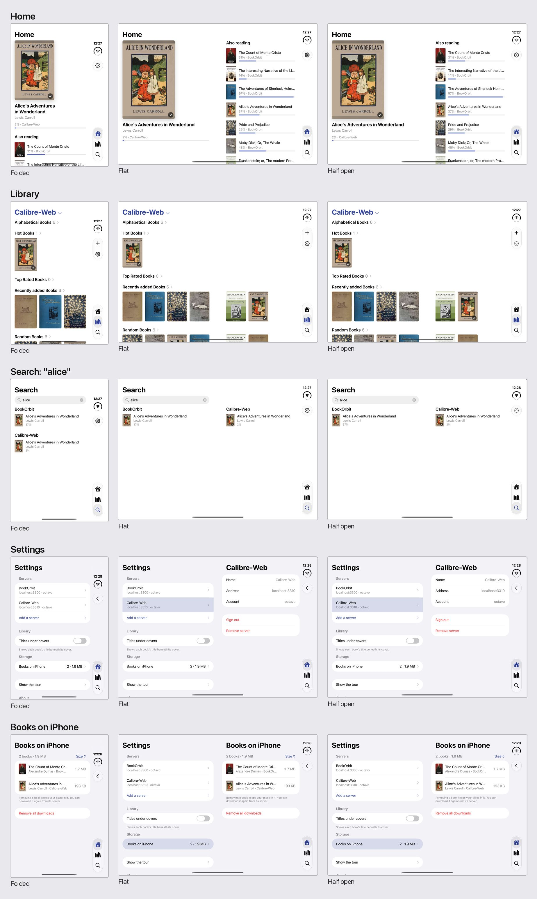

# More than one server (decision 36)

Octavo used to hold one server, and now holds any number. Decided with Adam on 2026-11-05 from screenshots of the real app running a throwaway prototype (`docs/design/direction.md`, decision 36), and built the same day. Pictures are in `more-than-one-server/`.

## How it fits together

- **The list.** `ServerStore` keeps `SavedServers` (the servers, in order, and the chosen one) in `Servers.json`. A server from before the list, in `Server.json`, still reads as a list of one until the migration moves it.
- **Names.** `SavedServer.name` is the server's own name, with a number if another server already went by it ("Calibre-Web 2"), set when it's added and not renumbered later. `customName` is the name you gave it. `LibraryServer.name` is whichever applies, so every screen that names a server follows.
- **One connection per server.** `LibraryModel.connections` holds a `ServerConnection` for each: its server, sections, Continue reading and problem. `server`, `root` and `connectionProblem` are the Library's chosen one, so the Library's screens read as they did. Home merges every connection's list with the iPhone's. Each server has its own client and `ServerTransport`, as before, and `source(for:)` finds a book's library by its `SourcedBook.source`, so one server's links never go through another's.
- **Screens that go with a server.** `ShellRoute.belongs(to:)`: when a server is removed, only the screens showing its books or details close.
- **Search.** `SearchModel.sections` has one per server, plus imported books last with several. Each fills in when its server answers. With one server there's one section, and the screen is as it was.

## Keeping each server's books apart

BookOrbit numbers its files from 1 on every server, so a file's ID says nothing without its server. This is the full fix `settings.md` left for this step.

- **The key.** `LibraryFile.storageKey(in:)` is `<server ID>.book-<hash of the file ID>`, for the downloaded file, the place, the trip and the bookmarks. The hash means a hostile ID can't reach outside the folder. The server's ID is ours, and a dot ends it, so all of a server's files can be found by the prefix (`StoredBookKeys`), and `server-one.` doesn't match `server-one-more.`.
- **Imported books** keep the plain `book-<hash>`. They belong to no server, and the same file imported again still opens where it was.
- **In memory too.** `BookOpener`'s statuses and tasks, and `BookPages`, are keyed by `SourcedBook.ID`. They used to be keyed by the book's ID alone.
- **Keep books on iPhone.** A kept book waits under its server's ID. `RemovedServers.json` lists each removed server's identity and ID. The same address and account coming back takes everything back (`ShellModel.takeBackBooks`), at its new ID, once it's saved. Any other server has its own names, so finds none of it, which replaces deleting the removed server's data when the next one was added.
- **Remove books too** leaves nothing of it (Adam, from the security review): every file by its prefix, whether or not a record names it, its places and bookmarks, and no entry in `RemovedServers.json`.
- **A catalog with a key** can never be recognised (`LibraryServer.canReturn`), so nothing is listed for it, and its places and bookmarks go at once, as they'd never be read. Kept files stay listed in Storage.

## Moving an install over

`ServerStorageMigration`, a launch step after the sweep and before anything can save the list. It runs only while `Server.json` or `RemovedServer.json` is there, and each is deleted last, so a launch killed partway finishes next time: what has moved no longer has its old name.

| Before | What happens |
|---|---|
| A saved server | Every `book-*` file but the imported books' moves under its ID, in Books, ReadingPositions, Trips and Bookmarks. Unsent places get their new names. Records in Books on iPhone under older IDs of the same server take this one. Then `Servers.json`, then `Server.json` goes |
| No server, one removed with books kept | The same, under an ID made for it (`removed-<UUID>`), listed in `RemovedServers.json` |
| Neither | Nothing moves, and nothing is written, so the reinstall wipe still sees a new install |
| `Server.json` can't be read | Nothing moves, the step fails, and it tries again next launch. The sweep also deletes nothing |
| Before the first unlock | Doesn't run, like the other steps. The app reads `Server.json` as the list meanwhile, and books look not downloaded for that launch |

A place left by a book imported and since removed can't be told from the server's, so it moves with the server's and is orphaned: importing that file again starts at the beginning. Only a development install can have this.

**Checked with a real upgrade.** A clone of a simulator on the old build (`Octavo Multi Old`, 323D3021-61E1-486A-BAF4-52782A182AF5): BookOrbit signed in through real setup, one download, a place and a bookmark. Installed this build over it: every file moved under the server's ID, `Server.json` gone, still signed in, the book still marked downloaded, and it opens at the same page with its bookmark. **A real device is unchecked**, including Adam's Duo.

## The launch sweep

`KeychainSweep` keeps every saved server's items and deletes the rest, and removes the sign-in of each server flagged `signedOut`. If `Servers.json` or `Server.json` is there and can't be read, it deletes nothing, as before. A list that can't be decoded is replaced by the next server added, as the one saved server's file was, so it can't stop the sweep for good. The review and Adam's sign-off are in `docs/notes/network-trust.md`.

**An older build installed over this one** sees no `Server.json` and deletes every server's sign-in. No release has shipped, so this only touches a development install, such as a branch without this work installed on Adam's Duo.

## The Library's title

iOS's `Menu` morphs its label into the glass: built for a small button, it squashed a 34 pt title into a blob and hid it while open (Adam: "feels off"; `more-than-one-server/title-options.mp4` has the four tried). `LibraryServerMenu` is a plain button with a popover, attached to the title's bounds, in a list as tall as its rows, scrolling at 440 pt. No positions are worked out by hand. Checked with a long name, folded, flat and half open, and by folding and unfolding with it open: it stays under the title, on the left page.

## Checked on the simulator

`Octavo Multi Old` (323D3021-61E1-486A-BAF4-52782A182AF5), local BookOrbit and Calibre-Web, added through the real Add a server.

| What | Result |
|---|---|
| Add Calibre-Web from Settings | Lands on its Library, title "Calibre-Web ⌄" |
| Choose BookOrbit, relaunch | Remembered |
| Search "the" and "alice" | Real results from both, each with its own place |
| Alice on both | BookOrbit's 37%, Calibre-Web's opens at the start. Read to 2% on Calibre-Web: no file on BookOrbit's server changed (`sync-spike/tools/bo.sh` before and after) |
| Home | Every book names its server. Alice shows twice |
| Signed out of BookOrbit | Banner on Home, naming it; Sign in opens Sign in again for that server, and comes back |
| Remove Calibre-Web, keep books | The alert counts only its book (193 KB). Keychain rows 2 → 1, BookOrbit untouched, its records gone but the kept book's, Library moves to BookOrbit |
| Add Calibre-Web back | Its book and place under the new ID, Keychain rows 2 |

Screens in all postures are in `01-all-postures.jpg`. The signed-out case came from the simulator's clone sharing a refresh token with its original, whose test run rotated it, which is what a real session ending looks like.

## Tests

`OctavoTests/SeveralServersTests.swift`: the list and its old file, keys and what they can't reach, the migration (each row above, partial runs, a second run), the sweep with several servers, the opener by server, Home, problems, Search's sections, Add, Name, Remove and coming back, one book's sync on its own server, and telling the same server twice. Existing suites follow the new calls, and `RemoveServerTests` now has the new rule for another server.

## Not done

- **iCloud and KOReader sync** carry the places of OPDS and imported books (`docs/PLAN.md`, separate tasks).
- **A catalog whose key was wiped from the Keychain** stays in `Servers.json`, skipped at launch and shown nowhere (`libraryServer()` returns `nil`). Adding it again works, and the old entry stays. A read that fails before the first unlock looks the same, so it isn't deleted.
- **Keep books on iPhone** keeps a server's places, bookmarks, address and account until it comes back, with no limit. They're small and on the iPhone only, and Remove books too is the way to leave nothing. Removing a kept book in Storage afterwards leaves them.
