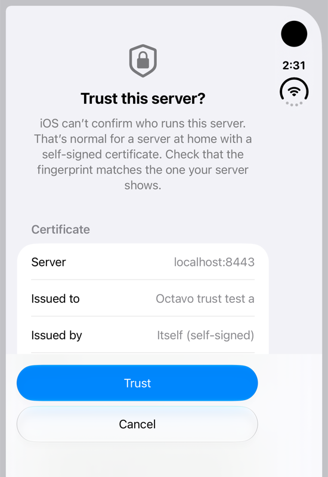
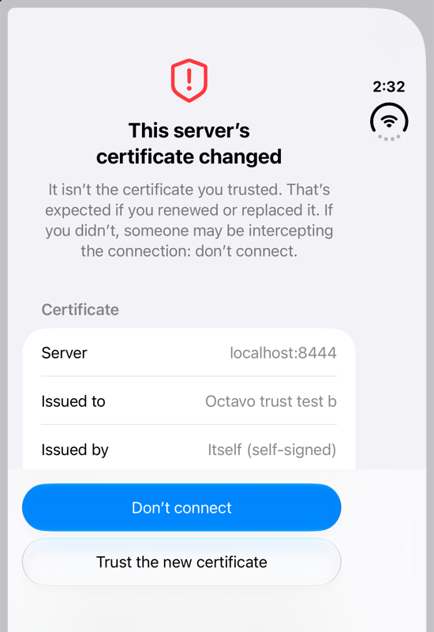
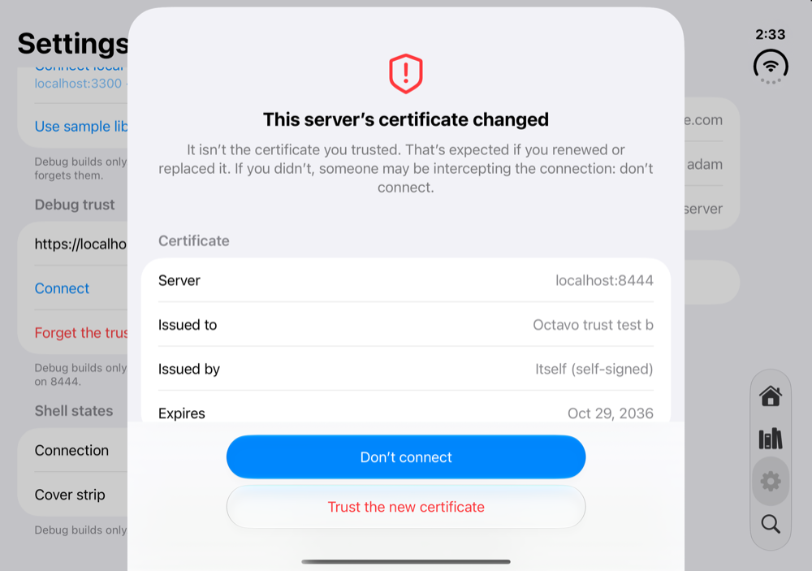
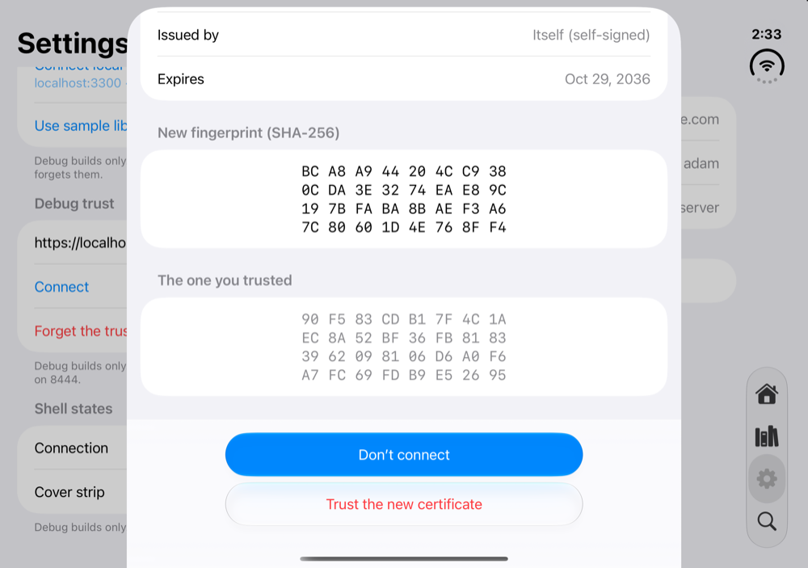
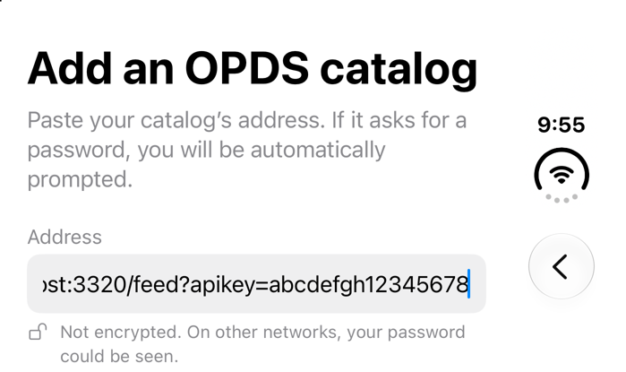
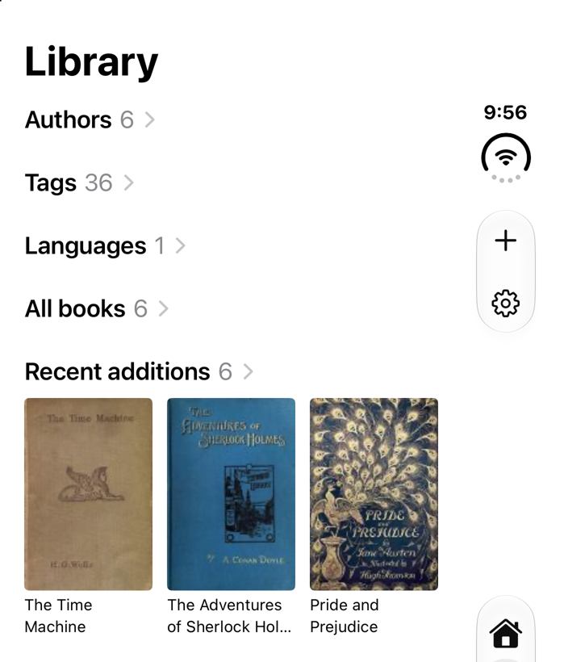
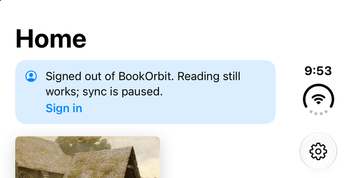
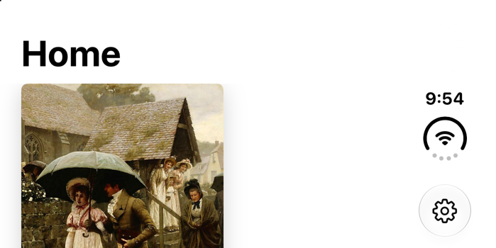

# Network trust and credentials (#9, D25)

Plain http only for home and VPN addresses, "Trust this server" for self-signed certificates, and credentials in the Keychain. Built and measured on the simulator **Octavo Trust Duo** (iOS 27.1), 2026-11-01. **Security-critical: Adam signed off the review below on 2026-11-01** (through commit `2257410`); later changes here need a new review.

Code: `Packages/OctavoKit/Sources/OctavoKit/Network/` (`IPAddress`, `HomeNetworkPolicy`, `ServerTransport`, `NetworkTrust`, `ExpiringActivity`), `…/Keychain/` (`KeychainItem`, `ServerCredentials` and the stores), `BookOrbitClient.swift` (transport, ordered saves), `Config/Octavo-Info.plist` (ATS), `Octavo/Trust/` (the proposed prompt and a DEBUG hook). Test servers: `dev/trust/` (self-signed HTTPS).

## Threat model

**What we protect:**
- BookOrbit access and refresh tokens. A refresh token is a 7-day session.
- OPDS usernames and passwords (Basic or Digest).
- Kavita's OPDS API key, which sits in the URL path.
- What a person reads.

**Who we defend against, and how:**

| # | Attacker or failure | Defence |
|---|---|---|
| 1 | Anyone on the internet path (ISP, the network behind public Wi-Fi) reading or changing traffic | Plain http goes only to home and VPN addresses (policy plus ATS). On https, either iOS trusts the certificate or it's pinned |
| 2 | A saved http server that now resolves to the internet (away from home, split DNS, an ISP that answers unknown names) | The address is checked before **every** request and redirect, and every address the name resolves to must be home |
| 3 | Address spellings that hide a public IP (`16843009`, `0x7f000001`, `0177.0.0.1`) | Only standard spellings are accepted. These are refused before DNS and before ATS |
| 4 | A man in the middle with a different certificate for a self-signed server | Exact-certificate pin. The pin wins even over a certificate iOS trusts (an MDM or proxy root). Any change asks again, with a heavier prompt |
| 5 | Hostile catalog content: links and redirects aimed at the home network, other hosts, or http | A server on the internet can't send the app to home addresses. No https→http redirects. Cross-origin redirects lose `Authorization` and `Cookie` and can't resend a body. Pins and passwords apply to the server's own host and port only |
| 6 | A proxy (Wi-Fi proxy, PAC, profile) resolving the name itself | Plain http through any proxy is refused |
| 7 | The app dying or being suspended mid token rotation | Saves replace the Keychain item in place and land in order. The refresh runs inside an expiring background activity. BookOrbit's 30 s grace covers a crash |
| 8 | Backups, other devices, a reinstall | Keychain items are `AfterFirstUnlockThisDeviceOnly` and not synced. Leftovers are wiped on the first launch after an install |

**Accepted residual risks:**
- **Someone else's network (D25).** A home address can't be told apart from the same address on another network (hotel Wi-Fi, a carrier using 10/8). An attacker there gets what you send to "192.168.1.5". Mitigations:
  - 100.64.0.0/10 counts as home only while a VPN tunnel holds such an address.
  - #12 shows a short note when an http server is added.
- **First connection to a self-signed server.** Trust-on-first-use is only as good as the person's fingerprint check.
- **DNS answers changing between our check and the connection.** Accepted because the names allowed for http (local suffixes, single labels) are answered by LAN or VPN resolvers and mDNS. An attacker who controls those is already in residual 1.
- **Never relax the name rule to allow ordinary domains over http.** That would turn this window into classic DNS rebinding.
- **Out of scope:** a jailbroken device, code running inside the app, a compromised server.

## What ATS does on iOS 27.1 (measured)

Probe: an app-hosted test sending `URLSession` requests to each URL. `-1022` means ATS blocked it. A timeout or "can't find host" means ATS let it through. Raw results are in `network-trust/ats-probe.md`.

| Address | `NSAllowsLocalNetworking` only | + our exceptions | `NSAllowsArbitraryLoads` |
|---|---|---|---|
| 10/8, 172.16/12, 192.168/16, 127/8, 169.254/16, fc00::/7, fe80::/10, `::1`, and `::ffff:` forms of these | allowed | allowed | allowed |
| 100.64/10 (Tailscale) | **blocked** | allowed | allowed |
| `nas` (single label), `nas.local` | allowed | allowed | allowed |
| `nas.lan`, `nas.internal`, `nas.home.arpa`, `nas.ts.net` | **blocked** | allowed | allowed |
| A name resolving to a LAN IP (`192-168-1-122.sslip.io`) | blocked | blocked | allowed |
| Public IP literals and names | blocked | blocked | allowed |
| **`16843009` (1.1.1.1), `0x7f000001`, `3232235898`** | **allowed: ATS reads them as single-label names and connects to the number** | same | allowed |
| `localhost.`, `nas.lan.` (trailing dot) | blocked | blocked | allowed |

- With arbitrary loads, `0300.0250.1.0172` reached 192.168.1.122 (octal), but `0177.0.0.1` timed out instead of reaching 127.0.0.1. That's why the policy refuses every non-standard spelling instead of interpreting them.
- **Self-signed certificates:** a delegate can accept one only on ATS-exempt hosts. On other names ATS fails the connection with `-1200` (the docs: with ATS on you can tighten trust evaluation but not loosen it).
- **IDNs:** `URL(string:)` maps fullwidth letters and `。` to ASCII and sends internationalized names as punycode in `absoluteString`, but `host(percentEncoded: true)` returns them percent-encoded. The policy reads the host from `URLComponents(string: url.absoluteString)?.encodedHost`, which is what gets sent.
- **IPv6 homes:** on Adam's Wi-Fi, `MacBook-Pro.local` resolves to 192.168.1.122, a `fe80::` address **and a global `2603:…` address**. A rule requiring every address to be in a fixed range would refuse every `.local` NAS on an IPv6 home. Hence the "on this network" rule for global IPv6.
- **ATS hole worth reporting:** the decimal-IP case is an ATS bypass (plain http to any public IP when `NSAllowsLocalNetworking` is set). Per the standing rule, vet it in a separate session before any report to Apple, and only with Adam's OK.

## Decisions

On 2026-11-01 Adam asked Claude to make these technical calls and audit them adversarially instead of putting each to him. The audit's findings and what changed are listed further down.

### 1. ATS: exceptions only, no arbitrary loads
`NSAllowsLocalNetworking` plus `NSExceptionDomains` with `NSExceptionAllowsInsecureHTTPLoads` for:
- `100.64.0.0/10` (CIDR keys work since iOS 17)
- `home.arpa`, `internal`, `lan` and `ts.net`, all with subdomains

ATS stays on for the internet. `HomeNetworkPolicy` is the real check inside that fence and catches what ATS misses.

**Change to D25:** a name outside those suffixes that resolves to a home address (split DNS, e.g. `books.example.com` → 192.168.1.5) can't use http or a self-signed certificate. It needs a real certificate, or the IP or a `.lan` name. `NSAllowsArbitraryLoads` would allow it, but it turns ATS off app-wide and needs a harder App Review justification.

**App Review justification (draft):**
> Octavo reads books from the user's own self-hosted servers (OPDS catalogs, BookOrbit). These commonly run on a home network or a Tailscale VPN without TLS. The insecure-HTTP exceptions are limited to the RFC 6598 range used by Tailscale and to special-use local domains (home.arpa, .internal, .lan, ts.net). The app also checks every plain-HTTP request and refuses it unless every address the server resolves to is a private, link-local or VPN address, so passwords and tokens are never sent unencrypted over the internet. Self-signed certificates are accepted only after the user confirms the certificate's fingerprint, and only that exact certificate is accepted afterwards.

### 2. The address rule (`HomeNetworkPolicy`)
- **Every URL:**
  - http or https only.
  - No `user:password@`.
  - The host written the standard way: lowercase LDH labels with no trailing dot (IDNs in `xn--` form), or a standard IP literal.
  - A last label that's numeric or `0x`-hex means the host is meant as an IP address, so it must be a strict dotted quad.
- **Plain http, additionally:**
  - A home IP literal, or a local name: no dots, or under `.local`, `.lan`, `.internal`, `.home.arpa` or `.ts.net`.
  - Names (special ones included) are resolved with `getaddrinfo` (`AF_UNSPEC`, both families) and every address must be home:
    - the fixed ranges;
    - 100.64/10 only while a `utun` interface holds such an address;
    - a global IPv6 address only inside a /48-or-narrower prefix of a non-point-to-point interface that's up (the network the device is on now).
  - IP literals stick to the fixed ranges, because ATS refuses others.
  - No system proxy for the URL (`CFNetworkCopyProxiesForURL`). A PAC file counts as a proxy.
  - NAT64, 6to4, Teredo, IPv4-compatible, 0/8, multicast and unspecified addresses all fail closed.

### 3. What gets pinned: the exact leaf certificate (SHA-256 of its DER)
- **Why the whole certificate rather than its public key:** it's what D25 says, and its fingerprint is the one people can compare. Safari, NAS admin pages and `openssl x509 -fingerprint -sha256` all show it. A public-key pin would survive renewals that keep the key, but most self-signed renewals make a new key anyway, and almost nothing shows a public-key hash to compare against.
- **Rules:**
  - One pin per server, applied only to the server's own host and port.
  - With a pin, the presented leaf must match, even if iOS would trust a different certificate. Otherwise the result is `.certificateChanged`.
  - With no pin, iOS decides. A certificate it doesn't trust gives `.untrustedCertificate`.
  - Expiry and name don't matter for a pinned certificate: the person has seen them.
  - A changed certificate that iOS trusts (the server moved to a real certificate) can be accepted by clearing the pin (`CertificateSummary.pinToSave` is `nil`), so its renewals don't ask again.
- **Known cost:** servers that rotate self-signed leaves often ask again every time:
  - Caddy `tls internal` issues 12-hour leaves.
  - Traefik's default certificate changes on every restart.

  The heavier "changed" prompt is the mitigation. Those users are better served by installing their CA on the iPhone (then iOS trusts it) or a real certificate. A follow-up could pin a self-signed CA when the server sends it in the chain.

### 4. Keychain
- **Item settings:** `kSecClassGenericPassword`, one service per kind (BookOrbit tokens, server password, certificate pin), account = the server's ID (its `LibrarySourceID`). `kSecAttrAccessibleAfterFirstUnlockThisDeviceOnly`, not synchronizable.
- **Consequence:** a new or restored iPhone signs in again. That's deliberate: refresh tokens rotate, so a restored copy would be stale anyway.
- **Writes** are `SecItemUpdate`, falling back to `SecItemAdd` only on `errSecItemNotFound`, and retried on a duplicate. Nothing is ever deleted first.
- **Sign out and Remove server:** `ServerCredentials.removeAll(serverID:)` clears all four kinds. `BookOrbitClient.signOut()` clears tokens. What a failed delete leaves goes at the next launch (step 16's sweep, below).
- **Reinstall:** `ServerCredentials.removeLeftoversAfterInstall(hasSavedServer:)` runs at launch when protected data is available (`LaunchSteps`; it never really ran until 2026-11-03, see "The launch steps never ran"). The marker is written only after the wipe succeeds. A saved server without the marker isn't a reinstall: its sign-in stays.
- **Token rotation:**
  - The refreshed credentials are saved before anything uses them.
  - Saves are chained, so they land in the order made. Sign-out bumps a generation number, so a refresh already in flight can't bring the session back.
  - A failed save leaves the new token in memory and is retried on the next request; the refresh itself still succeeds.
  - The refresh and its save run inside `ProcessInfo.performExpiringActivity`, so suspension doesn't cut them off.
  - If the app dies between BookOrbit rotating and our save, the Keychain still holds the old token. BookOrbit accepts it for 30 s. After that the session is over and the person signs in again.

### 5. The shared piece: `ServerTransport`, not a raw `URLSession`
URLSession has no hook before an http request is sent, so the per-request check lives in a wrapper.
- **Interface:** `HTTPTransport` (`data(for:)`, `download(for:delegate:)`). `ServerTransport(server:pin:passwords:policy:configuration:)`, one per server; a new pin needs a new transport.
- **Delegate per task:** each task gets a `TaskGuard` that handles challenges and redirects and forwards everything else to the caller's delegate (download progress). The exceptions are callbacks that could swap the request after the check (`willBeginDelayedRequest`, `needNewBodyStream`).
- **Session settings:** no session delegate, no cookie jar, no `URLCredentialStorage`, no `URLCache` (a cached answer would skip the connection checks), TLS 1.2 minimum.
- **After each request,** its metrics show where it really connected. Plain http that landed outside home addresses, went through a proxy, or can't be verified (no address in the metrics, or none within 5 s) fails, and so does an internet server's request that landed on a home address. This can't unsend the request, but the app never uses the answer.
- **Basic and Digest** challenges are answered from the `PasswordStore`, only for the server's own host, port and scheme, and only once.
- **For #8:** take `any HTTPTransport` and a `PasswordStore`. In tests, use `ServerTransport(server:policy:configuration:)` with a stub `URLProtocol` and a fake resolver (`HomeNetworkPolicyTests.swift` has `HomeNetworkPolicy.testing`). There's deliberately no `URLSession: HTTPTransport` conformance, so nothing can skip the rules.

### 6. The "Trust this server" prompt: approved by Adam (2026-11-01)
`Octavo/Trust/TrustServerView.swift`. Its real homes are first run (#12) and Settings (#16). For now a DEBUG section in the Settings stand-in ("Debug trust") drives it against `dev/trust/`.
- **First time:** a shield icon and "Trust this server?", a one-line explanation, then:
  - the certificate: server, issued to, issued by ("Itself (self-signed)"), expiry;
  - the SHA-256 fingerprint in four rows of eight bytes;
  - Trust and Cancel buttons.
- **Changed (heavier):** a red shield and "This server's certificate changed", a warning line, then:
  - the new fingerprint and the one trusted before;
  - "Don't connect" as the prominent button and "Trust the new certificate" in red.

 
 

The folded "changed" shot predates the red tint on the second button. Unfolding while the DEBUG sheet is up rebuilds the Settings panes and drops the sheet; #12/#16 should present it from state that survives a fold.

## Adversarial audit (independent reviewer, 2026-11-01) and what changed

| # | Finding | Severity | Done |
|---|---|---|---|
| 1 | Credentials in URLs: Kavita's OPDS link carries its API key in the path and every feed link; `user:pass@` URLs end up in saved data, the disk cache and logs | High | `user:pass@` refused, disk cache off. **#8 and #12:** keep Kavita's key and other in-URL secrets in the Keychain and rebuild URLs (or send `x-api-key`) at request time. Never persist key-bearing URLs |
| 2 | Leaf pins plus routine rotation (Caddy 12 h, Traefik on restart) train people to accept the attack | Med-high | Kept exact pins (D25). The "changed" prompt is heavier. CA pinning is a follow-up |
| 3 | "iOS trusts it" silently replaced a pin (MDM or proxy roots) | Medium | Fixed: the pin wins, and a system-trusted replacement asks once and then clears the pin |
| 4 | A system proxy makes the DNS check meaningless | Medium | Fixed: plain http through any proxy is refused |
| 5 | Feed links and redirects aimed at the LAN from an internet catalog | Medium | Fixed: an internet server's transport refuses home addresses |
| 6 | A suspension between rotation and save signs people out | Medium | Fixed: expiring background activity. Ordered saves plus the generation check |
| 7 | 100.64/10 is the carrier's space when Tailscale is off | Med-low | Fixed: home only while a `utun` holds such an address |
| 8 | The https path skipped the host rules; trust prompts for other hosts | Low-med | Fixed: standard spellings for every scheme; trust errors only for the server's own origin |
| 9 | 307/308 cross-origin redirects resend the body (login, refresh) | Low-med | Fixed: refused |
| 10 | A Digest→Basic downgrade by an attacker at the residual http address | Low | **#8:** remember the auth scheme a server used at setup and refuse a weaker one |
| 11 | The caller's task delegate could override the policy | Low | `TaskGuard` is always the task delegate and withholds request-changing callbacks |
| 12 | Keychain details: add only on not-found, interaction-not-allowed isn't sign-out, wipe only with protected data, clear caches on remove | Low | Done. The cache is memory-only and per transport, so dropping the transport clears it |

## Reviews before sign-off (2026-11-01)

- **Adversarial design audit:** 12 findings. Disposition is in the table above.
- **`/security-review`** of `cfe9dce`: **no findings at its reporting bar.** It checked about 40 hostile URL spellings against Foundation's and CFNetwork's parsers, two-hop redirects against real CFNetwork, pin matching, delegate forwarding, Keychain queries, token rotation and DEBUG gating.
  - It measured that CFNetwork already drops `Authorization` on cross-origin redirects but **does** forward a hand-set `Cookie`, so the explicit strip matters. It also measured that 307 resends a POST body even though `newRequest.httpBody` reads nil, so checking the method is the right test.
  - Two items below the bar are fixed in `b494dc9`: a sign-out during the first Keychain load could be undone, and errors carried full URLs (now scheme, host and port only).
- **Automated security review (plugin), on each commit:**
  - *DNS changing between check and connection:* accepted as a residual, with defence in depth added. The metrics check after each request fails plain http that landed outside home addresses, went through a proxy, or can't be verified.
  - *An internet server reaching home by DNS rebinding:* http was already blocked, and https fails at TLS. Hardened anyway: `0.0.0.0` and `::` now count as local, and the metrics check covers it.
  - *A refused answer served from the URL cache:* the cache is gone.
  - *Metrics arriving after the response:* the transport now waits for them, failing closed for http.
  - *Parity of the home check for internet servers:* fixed.
- **High-effort code review:** 8 findings, all fixed in `c0c00c6`:
  - a LAN proxy made internet servers look "home";
  - IDN and zoned hosts never matched their pin or password, so a single `URL.connectionHost` now feeds both checks;
  - cancellation was misreported;
  - an undecodable Keychain item wedged the session;
  - a login during a refresh gave a spurious "signed out";
  - an unnecessary metrics wait, duplicated host parsing, and a redundant overload.

- **Requests from #8 (OPDS), and one more automated finding (`2026-11-01`, after `6947b87`):**
  - **Auth-scheme pinning:** `ServerTransport(…, authScheme:)` answers Basic or Digest challenges only in the scheme recorded when the server was added, and none when it's `nil`. An impostor at a home http address can't downgrade a Digest server to Basic.
  - **Size cap:** `data(for:)` stops past `maximumDataSize` (default 64 MB), from `expectedContentLength` and while streaming, with `URLError(.dataLengthExceedsMaximum)`. Downloads go to a file, uncapped.
  - **Regression fixed:** the "internet server can't reach home" rule also hit the server's own address, so a split-DNS https server (real certificate, resolving to 192.168.x at home) refused its own requests. The rule now covers only *other* hosts it links to, and those are resolved before the request (names that resolve home are refused). That also closes the proxy gap the automated review raised.

## Review checklist (signed off by Adam, 2026-11-01)

- [x] Plain http can't reach a public address: IP literal, name, mixed DNS answer, redirect, proxy, odd spelling (`HomeNetworkPolicyTests`, `ServerTransportTests`; live `decimalAddressesAreStoppedBeforeATS`).
- [x] The address is checked before every request and redirect, not only when a server is added (`rechecksTheAddressBeforeEveryRequest`).
- [x] ATS config matches `HomeNetworkPolicy.localSuffixes`, with no `NSAllowsArbitraryLoads`.
- [x] A self-signed certificate is accepted only with a matching pin, only for the server's own host and port; a change and a system-trusted replacement both ask (`ServerTrustLiveTests`, app `selfSignedCertificateOnTheLAN`).
- [x] Credentials never ride a cross-origin redirect, a downgrade or a cookie jar; passwords answer only the server's own challenges, once.
- [x] Tokens: saved before use, in order, survive a failed save, a crash inside the grace window and a sign-out racing a refresh (`BookOrbitTokenRotationTests`).
- [x] Keychain: this device only, updated in place, cleared by Remove server and by a reinstall (`KeychainTests`).
- [x] Nothing logs or prints secrets (`PasswordCredentials` redacts; `BookOrbitCredentials` is never logged).
- [x] Residual risks above are acceptable.

## Step 16: security follow-up (2026-11-02)

The leftovers from this review, step 14's and the setup review, all Low or Info. Built on branch `claude/security-follow-up-28ea8f`; measured on the simulator **iPhone Duo** (8C35AF6E-5F3F-48D7-A283-AEE894511947) and this Mac. **Network-trust changes: Adam signed off the review below on 2026-11-02** (through commit `2d955c7`).

### 1. Is a server home by its name alone? (#9) No, measured

`HomeNetworkPolicy.check` resolves every plain-http name before every request and redirect, and every address must be home; `verify` then checks where each request actually connected. The name rule only decides which names may *try* plain http (what ATS lets through). Measured with the real resolver, not reasoned:

| Host | What it resolves to (this Mac, 2026-11-02) | ATS by shape | Result |
|---|---|---|---|
| `uz`, `tk`, `cm` (top-level domains with addresses of their own) | 91.212.89.8, 217.119.57.22, 195.24.205.60 | allowed (single label) | refused, `internetAddress`, before any connection |
| `octavo-probe-public.local` (Bonjour answer from `dns-sd -P`, as a hostile device on the Wi-Fi could send) | 203.0.113.7 | allowed (`.local`) | refused; on the simulator in under 2 s, so no connection was tried (TEST-NET never answers) |
| `octavo-probe-v6.local` | 2001:db8::7 | allowed | refused |
| `octavo-probe-home.local` | 192.168.1.250 | allowed | allowed |
| `MacBook-Pro.local` (this Mac) | 192.168.1.122, `fe80::…`, `fdb8:…`, global `2603:7001:f100:669:…` | allowed | allowed (the global IPv6 address is inside this network's /64), and BookOrbit at `:3300` loads through `ServerTransport` and its connection check |

A search domain does the same to a single label (`nas` → `nas.example.com`); the Mac's own search domain is Tailscale's (`nas` → `nas.<tailnet>.ts.net` → 100.x, home only while the tunnel holds such an address). Tests: `HomeNetworkLiveTests` (Kit, `OCTAVO_LIVE_DNS=1`), `NetworkTrustLiveTests.namesAreJudgedByWhereTheyResolve` (app, `TEST_RUNNER_OCTAVO_LIVE_DNS=1` after `network-trust/mdns-probes.sh start`), `HomeNetworkPolicyTests.namesWithoutDotsStillHaveToResolveHome`.

What *is* judged by the name alone, on purpose:
- `ServerAddress.parse` adds `http://` to a scheme-less local name and `https://` otherwise: only the scheme; the transport still checks.
- `TrustRules.serverIsLocal` (`isLocalAddress`): whether a server's pages may send the app to home addresses on other hosts (rule 5). An https server needs a certificate that passes: a local name can't get a public one, only a pin the person trusted, so it's their own server. (A `ts.net` name can have a real certificate, through `tailscale cert` or Funnel; it's still their server.)
- The residual stays as it was: DNS answers that change between the check and the connection (rebinding) are caught only afterwards by `verify`, which can't unsend the request.

### 2. The launch sweep (`Octavo/Setup/KeychainSweep.swift`)

At launch, when protected data is available and right after the reinstall wipe, `KeychainSweep.run()` lists every account under the four Keychain services and deletes all of a server's items unless it's the saved server's (`ServerCredentials.removeAll(keeping:)`). That covers a Remove server whose Keychain delete failed and the secrets of a setup left before it finished (or whose `Server.json` save failed).
- **Never on a guess:** `ServerStore.read()` tells "no file" (`nil`) from a file that can't be read or decoded (throws); a throw deletes nothing, and so does a Keychain that can't list its items. A file from before `signedOut` existed still decodes (the field is optional).
- **Never a setup in progress:** it runs in `didFinishLaunching` (`LaunchSteps`), before the shell exists and before anything can be tapped; setup stores its secrets under a new `server-<UUID>` per launch, so the only attempt IDs it can see are earlier processes' (abandoned).
- **Sign out:** an account sweep can't tell a stale sign-in from a live one, so Sign out first writes `signedOut = true` to `Server.json`, then deletes. At launch the sweep deletes a signed-out server's tokens and password (`ServerCredentials.removeSignIn`), keeping its pin and catalog key. Sign in again clears the flag. If that save fails, the next launch signs out again: fail closed.
- **Debug builds** keep accounts starting `debug-` (the local servers' fixed IDs, so launch arguments don't sign in on every launch). Release builds keep nothing but the saved server.

### 3. A pin that can't be read fails closed

`ServerTransport(server:pins:)` reads the pin from the server's `CertificatePinStore` before its first request, and keeps it once read. A read that throws fails that request with the `KeychainError` (the list shows its error and Retry reads again); it no longer turns into "no pin", which let iOS alone judge a self-signed server (and let an MDM or proxy root through). `SavedServer` and the debug trust section use it; `ServerTransport(server:pin:)` remains for a pin already in hand. A pin that no longer decodes (another build's format) now throws too, and stays in the Keychain, instead of being deleted as "no pin"; trusting the server again replaces it. A catalog key that can't be read still returns no server (`libraryServer() == nil`): closed, if not graceful.

### 4. Secrets in a catalog's address

What a typed address can carry, and where it goes now:

| In the address | Who uses it | Kept |
|---|---|---|
| `user:password@` | Codex's docs, generic | Moved to the account fields at setup (step 8); the transport refuses it anyway |
| `#fragment` | — | Dropped (step 8) |
| `…/api/opds/<key>` | Kavita | Keychain, `{key}` in saved values (#8) |
| `…/opds/<key>/v1.2/…` | Stump's router for readers without passwords | **Now** Keychain, `{key}` (a segment with a digit or `_`, as Stump's `stump_…_…` keys have, so `opds/discover/v1` isn't one) |
| `?apikey=`, `?token=`, `?password=`, `;jsessionid=`, … (query items and path parameters whose name contains key, token, secret, pass, pw, auth, bearer, session, sig, jwt or otp, or is `sid` or `code`) | Bindery's `?apikey=`, servlet sessions, generic | **Now** Keychain, `{key2}` and on for more than one |
| A query on a BookOrbit address | — | **Now** dropped: BookOrbit's address is its root |

Komga takes its API key only in a header; Calibre-Web, COPS and calibre use Basic or Digest. `OPDSURLSecret` holds several values, each as written in the address, percent-encoding and all, so the saved address is restored exactly (`?token=abc%26def` decoded would become two query items). Links are redacted in that form, decoded and fully encoded, longest first so one secret inside another doesn't split it. The Keychain item stays a JSON string for one (step 8's format) and becomes an array for more. A server saved before this step has its address's secrets moved out at launch (`ServerStore.moveSecretsOut`: Keychain first, then `Server.json`). A value shorter than 8 characters can't be swapped out of the server's links safely and stays as typed, as does a secret in a form nobody has shown us. Logs: `os.Logger` interpolations are private unless marked public, and no marked one carries a URL with a secret; OPDS errors drop the failing URL; `NetworkTrustError` carries scheme, host and port only.

### Independent security review (fresh subagent, given the code, 2026-11-02; signed off by Adam)

Of commit `e7b1395`. **Nothing High or Medium.** It found no defect in item 1 (no policy change; `check` resolves every plain-http name), in the fail-closed transport itself (every production `ServerTransport` reads its pin first; a failed read isn't cached) or in the sweep beyond row 3, and no way to get a secret sent to another origin with placeholders.

| # | Finding | Severity | Done |
|---|---|---|---|
| 1 | A secret was detected decoded but matched in the address only plain or fully encoded, so `?token=abc/def%3D%3D` (Python's, werkzeug's encoding) was saved as typed, and into `RemovedServer.json` | Low | Fixed: secrets are taken as written in the address; links are matched in that form, decoded and fully encoded (`keepsASecretAsItsWrittenInTheAddress`) |
| 2 | Restore put back the decoded value: `abc%26def%3Dghi` came back as two query items, `%2B` as a space, `%23` as a fragment (same origin only) | Low | Fixed with 1: the written form is stored and restored, so the address comes back exactly |
| 3 | A leftover item that wouldn't delete stopped the sweep before a signed-out server's sign-in went | Low | Fixed: both steps run, the first failure is thrown after |
| 4 | A pin that no longer decodes was deleted and read as "no pin" (older helper) | Low | Fixed: it throws and stays (`anUndecodablePinFailsClosed`) |
| 5 | Shapes not recognised (`?pw=`, `?bearer=`, `;jsessionid=`, Stump keys without a digit); no migration of servers saved earlier | Info | Added those; `moveSecretsOut` at launch. Values under 8 characters still stay as typed |
| 6 | The live test's "refused in under 2 s" didn't prove nothing was sent for `uz`, a host that answers | Info | The test now counts the transport's tasks: none for the refused names, one for the Mac's own `.local` |

### Checked by hand (iPhone Duo simulator, folded, local BookOrbit and COPS)
**Correction (2026-11-03):** the launch steps never ran in this build, so none of these checks exercised the sweep or `moveSecretsOut`. They passed without them. The real runs are under "The launch steps never ran".

- **Sweep keeps the saved server:** signed in to the saved BookOrbit (Sign in again, test account), relaunched: no banner, Home loads its books.
- **Sign out survives a relaunch:** Sign out wrote `"signedOut":true` to `Server.json`; relaunched signed out; Sign in again removed the flag, and a relaunch stayed signed in.
- **A query token stays out of saved data:** Remove server, then Add a server → OPDS catalog → `localhost:3320/feed?apikey=abcdefgh12345678` (the note below shows). Saved as `http://localhost:3320/feed?apikey={key}`; `abcdefgh12345678` appears in no file under Application Support or Preferences. After a relaunch COPS loads with the key from the Keychain. The app's data was then put back from a copy. This note used to add that the next launch's sweep dropped COPS's key; that was never measured, and the sweep couldn't have run, so the key stayed.

 
 

### 5. Adam's wording (2026-11-02, from simulator mockups)
- Remove server for a catalog with a key: **no extra line** (the key is deleted from the iPhone; like a password it stays valid on the server, which apps don't usually mention).
- The note under an http address: **"Not encrypted. On other networks, your password could be seen."** (was "Octavo uses http:// only at home or over a VPN.").

## The launch steps never ran (found and fixed 2026-11-03)

Measured on the simulator **Octavo Launch Duo** (06647D0C-07CE-4113-9EB1-ADE752C32737, iOS 27.1). **A real device is unchecked.** **Network-trust change: needs Adam's sign-off before merge** (independent review below).

**What was wrong.** The reinstall wipe, the sweep and `moveSecretsOut` sat in `OctavoApp.init` behind `if UIApplication.shared.isProtectedDataAvailable`, from the wipe's first commit (`cfe9dce`) on. They never ran: a reinstall's items stayed, and so did an abandoned setup's, a failed Remove server's and a failed Sign out's. Keychain items stayed `AfterFirstUnlockThisDeviceOnly`, and nothing ever sent them anywhere: no ID the app would use could reach them (setup always makes a new one).

**Why.** `App.init` runs before `UIApplicationMain`. A probe at each point, on a fresh install and a second launch:

| | `sharedApplication` | `isProtectedDataAvailable` | `UIApplicationMain` on the stack | Keychain, `Server.json`, defaults |
|---|---|---|---|---|
| `App.init` | **nil** | **false** (a message to nil) | no | all readable |
| `didFinishLaunching` | the app | true | yes | all readable |

So the check was false because there was no application yet, whatever the state of the data. The order at launch is `App.init`, `didFinishLaunching`, `App.body`, the window's content, `ShellModel.init`.

**What changed since step 16: nothing.** This note said the sweep dropped COPS's key on a simulator. Step 16's own commit (`2d955c7`), built with today's tools (Xcode dates from October 22), with an orphan item planted and a log added: "block SKIPPED" on both launches, and the orphan still there. That sentence was never measured, and the hand checks above pass with or without a sweep. The 2026-11-01 checklist's "cleared by … a reinstall (`KeychainTests`)" had the same gap: each test calls its function directly, so nothing tested launch itself.

**The fix (`Octavo/Setup/LaunchSteps.swift`).** `OctavoAppDelegate.application(_:didFinishLaunchingWithOptions:)`, through `@UIApplicationDelegateAdaptor`, calls `LaunchSteps.run(protectedDataAvailable: application.isProtectedDataAvailable)`. The order is unchanged: `TourRecord.settle()`, the wipe, the sweep, `moveSecretsOut`.
- **Before any setup stores:** the callback runs on the main thread, and nothing can be tapped until it returns. As measured, it also comes before the shell exists.
- **Before the first unlock:** nothing runs, and the next launch does it (as before; the check now works). The same goes for a launch while locked, because `isProtectedDataAvailable` is false then too. They don't run later in the same process, which could reach a setup in progress.

**Existing installs: the first run.** Every install so far has a saved server and no marker, which is what a reinstall looks like to the old check: its first real run would have deleted the live sign-in. `Server.json` goes with the app just as the marker does, so a saved server (readable or not) now means the install has run before, and only the marker is set (`removeLeftoversAfterInstall(hasSavedServer:)`). This also fixes a wipe that fails on the first launch and then deletes a server added since. It can't keep a stale secret: the sweep then removes everything but the saved server's items.

| Install on its first launch of this build | What's deleted | What you see |
|---|---|---|
| A saved server, signed in | Other servers' items: failed Remove servers, abandoned setups | Nothing. Still signed in, no tour |
| A saved server, signed out | Also its leftover tokens and password, if Sign out couldn't delete them | Nothing. Still signed out |
| A catalog with a key still in its saved address | Nothing; the key moves to the Keychain and the address gets a placeholder | Nothing. The catalog loads as before |
| No saved server | Every item, including `debug-` ones in debug builds | Setup, as before. Debug launch arguments sign in again once (BookOrbit allows 5 logins a minute, so a script that reinstalls in a loop could hit that) |

From now on a reinstall deletes the old items at its first launch, and what you see doesn't change: setup, as it was.

**Checked on the simulator**, with Keychain rows counted in the simulator's database (uninstalling doesn't remove them there, so a reinstall's wipe is really tested):

| Scenario | Before | After |
|---|---|---|
| Upgrade: step 16's build with a real BookOrbit sign-in and an orphan, then this build | 2 rows, no marker | 1 row, marker set, tour `played`; Home shows the server's books and places; the same on a second launch |
| Signed out with tokens still stored (`signedOut` set by hand) | 1 row | 0 rows |
| An older save: COPS at `…/feed?apikey=abcdefgh12345678` | 0 rows, key in `Server.json` | 1 row, address `…?apikey={key}`, key in no file under Application Support, Preferences or Documents; the Library loads from COPS |
| Reinstall: delete the app, install again | 1 row | 0 rows, marker set, tour playing, no server; the same on a second launch |

Not run: a launch before the first unlock (the simulator has no passcode; `nothingRunsBeforeTheFirstUnlock` passes the check's answer in) and a Release build (its only difference here is that `debug-` items aren't kept).

**Tests.** `launchRunsTheSteps`: this test host is the app, launched the real way, so `LaunchSteps.ranAtLaunch` (set only by the delegate), the marker in the real defaults and the tour's state must all be there. Five more in `KeychainTests` cover the steps together. Ten deliberate breakages were each caught, including the original bug put back (`launchRunsTheSteps`) and the wipe ignoring a saved server (`anInstallWithoutTheMarkerKeepsItsSavedServer`).

**The sweep could look at a live test.** An app test run on a simulator now sweeps that simulator's Keychain at launch, as any launch does. `reinstallStartsSignedOut` already wiped it, which also signs out an app installed there.

**Why the wipe is still here.** With no saved server, the sweep alone would now delete the same items in a Release build. The wipe is kept because it sets the marker, which `TourRecord` reads, and clears `debug-` items after a reinstall.

## Tests and how to run them

```bash
# OctavoKit (macOS): policy, transport, token rotation
cd Packages/OctavoKit && swift test
# + live self-signed servers
(cd ../../dev/trust && ./make-certs.sh && docker compose -p octavo-trust up -d)
OCTAVO_TRUST_HOST=localhost swift test --filter ServerTrustLiveTests
# App (simulator): Keychain, ATS, live LAN (one BookOrbit sign-in)
TEST_RUNNER_OCTAVO_LAN_BOOKORBIT=http://<Mac's Wi-Fi IP>:3300 TEST_RUNNER_OCTAVO_LAN_TRUST_HOST=<Mac's Wi-Fi IP> \
  xcodebuild test -project Octavo.xcodeproj -scheme Octavo -destination 'platform=iOS Simulator,name=Octavo Trust Duo,OS=27.1' -parallel-testing-enabled NO
# Step 16: names judged by where they resolve (internet DNS and Bonjour)
OCTAVO_LIVE_DNS=1 OCTAVO_LIVE_DNS_PORT=3300 swift test --filter HomeNetworkLiveTests
docs/notes/network-trust/mdns-probes.sh start
TEST_RUNNER_OCTAVO_LIVE_DNS=1 TEST_RUNNER_OCTAVO_LIVE_DNS_LOCAL_NAME=<LocalHostName>.local xcodebuild test … -parallel-testing-enabled NO
docs/notes/network-trust/mdns-probes.sh stop
```

## Follow-ups

- **#12, #16:**
  - Done in setup (step 8, `Octavo/Setup/`): the trust prompt as a setup step; typed addresses normalised (`ServerAddress`: a scheme added, http only for a home address; host lowercased without a trailing dot; IDNs as `xn--`; `user:pass@` moved to the account fields); the "Not encrypted" note under an http address; Kavita's key kept in the Keychain (`KeychainCatalogSecretStore`) and saved as `{key}`; secrets stored under a per-attempt ID, dropped when the address changes, so a certificate trusted for one server never applies to another.
  - Still to do (step 14): call `ServerCredentials.removeAll(serverID:)` on Remove server (setup's debug Disconnect does already).
  - **Setup review (2026-11-02, read-only, nothing High).** Fixed on the branch: an address edited mid-try could take the earlier server's sign-in request and its auth scheme (each try is now replaced on any edit, and a replaced try's answer is dropped); `host@other` sent the typed BookOrbit password to `other` on the same tap (an account in the address now moves to the fields and nothing is sent until the next tap); Sign in again kept an unverified OPDS password when the check threw, and an unreadable old password became "none" (restored on every error; unreadable stops it); a home address typed with an account or trailing dot got https. Setup's tries also give up after 15 s (a name lookup has no time limit, and a port that doesn't answer waits a minute). Left for step 16, done there (above): a Keychain read error at launch builds the server without its pin (fail closed); secrets from an abandoned setup stay until a reinstall; other in-address secrets are saved as typed; the "Not encrypted" note's wording.
- **#8:**
  - Wire `ServerTransport` and `KeychainPasswordStore`.
  - Keep Kavita's key out of saved URLs.
  - Refuse an auth-scheme downgrade.
  - Use one transport per source and never route one server's links through another's.
- **Vetting:** check the ATS decimal-IP bypass in a fresh session before any report to Apple (Adam's OK needed).
- **Later:**
  - Pin a self-signed CA when the server presents it.
  - Refresh ahead of expiry in the foreground.
  - One refresher per server once a widget extension exists.
