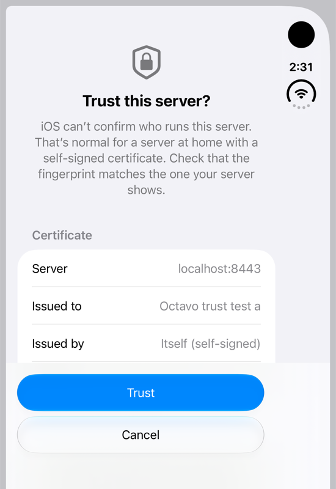
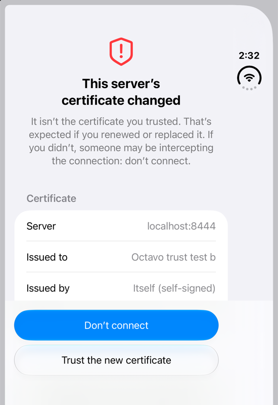
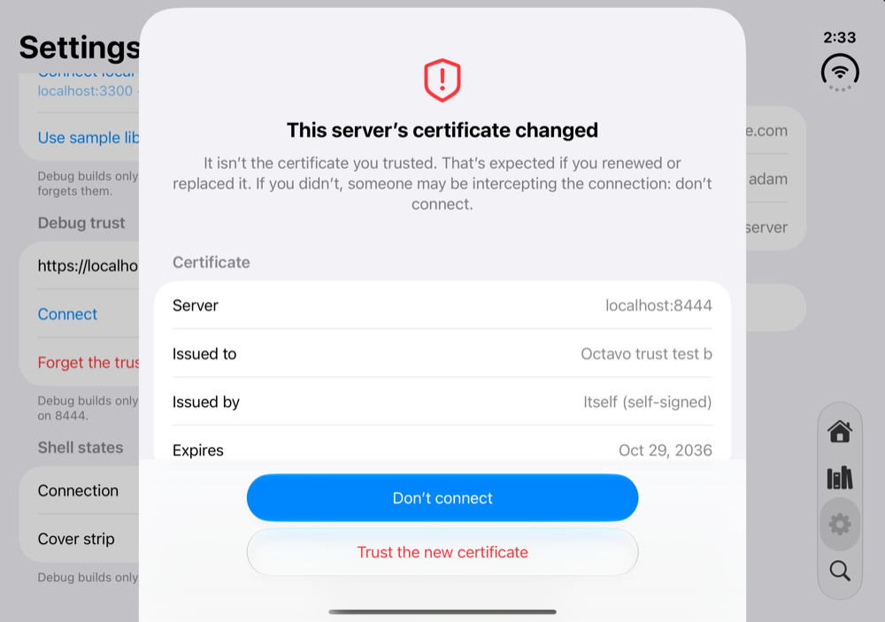
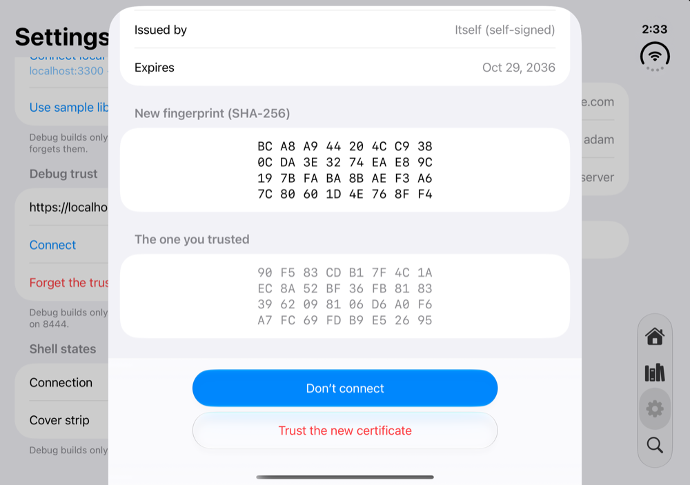

# Network trust and credentials (#9, D25)

Plain http only for home and VPN addresses, "Trust this server" for self-signed certificates, and credentials in the Keychain. Built and measured on the simulator **Octavo Trust Duo** (iOS 27.1), 2026-11-01. **Security-critical: Adam signs off the review below before this merges.**

Code: `Packages/OctavoKit/Sources/OctavoKit/Network/` (`IPAddress`, `HomeNetworkPolicy`, `ServerTransport`, `NetworkTrust`, `ExpiringActivity`), `…/Keychain/` (`KeychainItem`, `ServerCredentials` and the stores), `BookOrbitClient.swift` (transport, ordered saves), `Config/Octavo-Info.plist` (ATS), `Octavo/Trust/` (the proposed prompt and a DEBUG hook). Test servers: `dev/trust/` (self-signed HTTPS).

## Threat model

**What we protect:**
- BookOrbit access and refresh tokens. A refresh token is a 7-day session.
- OPDS usernames and passwords (Basic or Digest).
- Kavita's OPDS API key, which sits in the URL path.
- What a person reads.

**Who we defend against, and how:**

| # | Attacker or failure | Defence |
|---|---|---|
| 1 | Anyone on the internet path (ISP, the network behind public Wi-Fi) reading or changing traffic | Plain http goes only to home and VPN addresses (policy plus ATS). On https, either iOS trusts the certificate or it's pinned |
| 2 | A saved http server that now resolves to the internet (away from home, split DNS, an ISP that answers unknown names) | The address is checked before **every** request and redirect, and every address the name resolves to must be home |
| 3 | Address spellings that hide a public IP (`16843009`, `0x7f000001`, `0177.0.0.1`) | Only standard spellings are accepted. These are refused before DNS and before ATS |
| 4 | A man in the middle with a different certificate for a self-signed server | Exact-certificate pin. The pin wins even over a certificate iOS trusts (an MDM or proxy root). Any change asks again, with a heavier prompt |
| 5 | Hostile catalog content: links and redirects aimed at the home network, other hosts, or http | A server on the internet can't send the app to home addresses. No https→http redirects. Cross-origin redirects lose `Authorization` and `Cookie` and can't resend a body. Pins and passwords apply to the server's own host and port only |
| 6 | A proxy (Wi-Fi proxy, PAC, profile) resolving the name itself | Plain http through any proxy is refused |
| 7 | The app dying or being suspended mid token rotation | Saves replace the Keychain item in place and land in order. The refresh runs inside an expiring background activity. BookOrbit's 30 s grace covers a crash |
| 8 | Backups, other devices, a reinstall | Keychain items are `AfterFirstUnlockThisDeviceOnly` and not synced. Leftovers are wiped on the first launch after an install |

**Accepted residual risks:**
- **Someone else's network (D25).** A home address can't be told apart from the same address on another network (hotel Wi-Fi, a carrier using 10/8). An attacker there gets what you send to "192.168.1.5". Mitigations:
  - 100.64.0.0/10 counts as home only while a VPN tunnel holds such an address.
  - #12 shows a short note when an http server is added.
- **First connection to a self-signed server.** Trust-on-first-use is only as good as the person's fingerprint check.
- **DNS answers changing between our check and the connection.** Accepted because the names allowed for http (local suffixes, single labels) are answered by LAN or VPN resolvers and mDNS. An attacker who controls those is already in residual 1.
- **Never relax the name rule to allow ordinary domains over http.** That would turn this window into classic DNS rebinding.
- **Out of scope:** a jailbroken device, code running inside the app, a compromised server.

## What ATS does on iOS 27.1 (measured)

Probe: an app-hosted test sending `URLSession` requests to each URL. `-1022` means ATS blocked it. A timeout or "can't find host" means ATS let it through. Raw results are in `network-trust/ats-probe.md`.

| Address | `NSAllowsLocalNetworking` only | + our exceptions | `NSAllowsArbitraryLoads` |
|---|---|---|---|
| 10/8, 172.16/12, 192.168/16, 127/8, 169.254/16, fc00::/7, fe80::/10, `::1`, and `::ffff:` forms of these | allowed | allowed | allowed |
| 100.64/10 (Tailscale) | **blocked** | allowed | allowed |
| `nas` (single label), `nas.local` | allowed | allowed | allowed |
| `nas.lan`, `nas.internal`, `nas.home.arpa`, `nas.ts.net` | **blocked** | allowed | allowed |
| A name resolving to a LAN IP (`192-168-1-122.sslip.io`) | blocked | blocked | allowed |
| Public IP literals and names | blocked | blocked | allowed |
| **`16843009` (1.1.1.1), `0x7f000001`, `3232235898`** | **allowed: ATS reads them as single-label names and connects to the number** | same | allowed |
| `localhost.`, `nas.lan.` (trailing dot) | blocked | blocked | allowed |

- With arbitrary loads, `0300.0250.1.0172` reached 192.168.1.122 (octal), but `0177.0.0.1` timed out instead of reaching 127.0.0.1. That's why the policy refuses every non-standard spelling instead of interpreting them.
- **Self-signed certificates:** a delegate can accept one only on ATS-exempt hosts. On other names ATS fails the connection with `-1200` (the docs: with ATS on you can tighten trust evaluation but not loosen it).
- **IDNs:** `URL(string:)` maps fullwidth letters and `。` to ASCII and sends internationalized names as punycode in `absoluteString`, but `host(percentEncoded: true)` returns them percent-encoded. The policy reads the host from `URLComponents(string: url.absoluteString)?.encodedHost`, which is what gets sent.
- **IPv6 homes:** on Adam's Wi-Fi, `MacBook-Pro.local` resolves to 192.168.1.122, a `fe80::` address **and a global `2603:…` address**. A rule requiring every address to be in a fixed range would refuse every `.local` NAS on an IPv6 home. Hence the "on this network" rule for global IPv6.
- **ATS hole worth reporting:** the decimal-IP case is an ATS bypass (plain http to any public IP when `NSAllowsLocalNetworking` is set). Per the standing rule, vet it in a separate session before any report to Apple, and only with Adam's OK.

## Decisions

On 2026-11-01 Adam asked Claude to make these technical calls and audit them adversarially instead of putting each to him. The audit's findings and what changed are listed further down.

### 1. ATS: exceptions only, no arbitrary loads
`NSAllowsLocalNetworking` plus `NSExceptionDomains` with `NSExceptionAllowsInsecureHTTPLoads` for:
- `100.64.0.0/10` (CIDR keys work since iOS 17)
- `home.arpa`, `internal`, `lan` and `ts.net`, all with subdomains

ATS stays on for the internet. `HomeNetworkPolicy` is the real check inside that fence and catches what ATS misses.

**Change to D25:** a name outside those suffixes that resolves to a home address (split DNS, e.g. `books.example.com` → 192.168.1.5) can't use http or a self-signed certificate. It needs a real certificate, or the IP or a `.lan` name. `NSAllowsArbitraryLoads` would allow it, but it turns ATS off app-wide and needs a harder App Review justification.

**App Review justification (draft):**
> Octavo reads books from the user's own self-hosted servers (OPDS catalogs, BookOrbit). These commonly run on a home network or a Tailscale VPN without TLS. The insecure-HTTP exceptions are limited to the RFC 6598 range used by Tailscale and to special-use local domains (home.arpa, .internal, .lan, ts.net). The app also checks every plain-HTTP request and refuses it unless every address the server resolves to is a private, link-local or VPN address, so passwords and tokens are never sent unencrypted over the internet. Self-signed certificates are accepted only after the user confirms the certificate's fingerprint, and only that exact certificate is accepted afterwards.

### 2. The address rule (`HomeNetworkPolicy`)
- **Every URL:**
  - http or https only.
  - No `user:password@`.
  - The host written the standard way: lowercase LDH labels with no trailing dot (IDNs in `xn--` form), or a standard IP literal.
  - A last label that's numeric or `0x`-hex means the host is meant as an IP address, so it must be a strict dotted quad.
- **Plain http, additionally:**
  - A home IP literal, or a local name: no dots, or under `.local`, `.lan`, `.internal`, `.home.arpa` or `.ts.net`.
  - Names (special ones included) are resolved with `getaddrinfo` (`AF_UNSPEC`, both families) and every address must be home:
    - the fixed ranges;
    - 100.64/10 only while a `utun` interface holds such an address;
    - a global IPv6 address only inside a /48-or-narrower prefix of a non-point-to-point interface that's up (the network the device is on now).
  - IP literals stick to the fixed ranges, because ATS refuses others.
  - No system proxy for the URL (`CFNetworkCopyProxiesForURL`). A PAC file counts as a proxy.
  - NAT64, 6to4, Teredo, IPv4-compatible, 0/8, multicast and unspecified addresses all fail closed.

### 3. What gets pinned: the exact leaf certificate (SHA-256 of its DER)
- **Why the whole certificate rather than its public key:** it's what D25 says, and its fingerprint is the one people can compare. Safari, NAS admin pages and `openssl x509 -fingerprint -sha256` all show it. A public-key pin would survive renewals that keep the key, but most self-signed renewals make a new key anyway, and almost nothing shows a public-key hash to compare against.
- **Rules:**
  - One pin per server, applied only to the server's own host and port.
  - With a pin, the presented leaf must match, even if iOS would trust a different certificate. Otherwise the result is `.certificateChanged`.
  - With no pin, iOS decides. A certificate it doesn't trust gives `.untrustedCertificate`.
  - Expiry and name don't matter for a pinned certificate: the person has seen them.
  - A changed certificate that iOS trusts (the server moved to a real certificate) can be accepted by clearing the pin (`CertificateSummary.pinToSave` is `nil`), so its renewals don't ask again.
- **Known cost:** servers that rotate self-signed leaves often ask again every time:
  - Caddy `tls internal` issues 12-hour leaves.
  - Traefik's default certificate changes on every restart.

  The heavier "changed" prompt is the mitigation. Those users are better served by installing their CA on the iPhone (then iOS trusts it) or a real certificate. A follow-up could pin a self-signed CA when the server sends it in the chain.

### 4. Keychain
- **Item settings:** `kSecClassGenericPassword`, one service per kind (BookOrbit tokens, server password, certificate pin), account = the server's ID (its `LibrarySourceID`). `kSecAttrAccessibleAfterFirstUnlockThisDeviceOnly`, not synchronizable.
- **Consequence:** a new or restored iPhone signs in again. That's deliberate: refresh tokens rotate, so a restored copy would be stale anyway.
- **Writes** are `SecItemUpdate`, falling back to `SecItemAdd` only on `errSecItemNotFound`, and retried on a duplicate. Nothing is ever deleted first.
- **Sign out and Remove server:** `ServerCredentials.removeAll(serverID:)` clears all three kinds. `BookOrbitClient.signOut()` clears tokens.
- **Reinstall:** `ServerCredentials.removeLeftoversAfterInstall()` runs at launch when protected data is available. The marker is written only after the wipe succeeds.
- **Token rotation:**
  - The refreshed credentials are saved before anything uses them.
  - Saves are chained, so they land in the order made. Sign-out bumps a generation number, so a refresh already in flight can't bring the session back.
  - A failed save leaves the new token in memory and is retried on the next request; the refresh itself still succeeds.
  - The refresh and its save run inside `ProcessInfo.performExpiringActivity`, so suspension doesn't cut them off.
  - If the app dies between BookOrbit rotating and our save, the Keychain still holds the old token. BookOrbit accepts it for 30 s. After that the session is over and the person signs in again.

### 5. The shared piece: `ServerTransport`, not a raw `URLSession`
URLSession has no hook before an http request is sent, so the per-request check lives in a wrapper.
- **Interface:** `HTTPTransport` (`data(for:)`, `download(for:delegate:)`). `ServerTransport(server:pin:passwords:policy:configuration:)`, one per server; a new pin needs a new transport.
- **Delegate per task:** each task gets a `TaskGuard` that handles challenges and redirects and forwards everything else to the caller's delegate (download progress). The exceptions are callbacks that could swap the request after the check (`willBeginDelayedRequest`, `needNewBodyStream`).
- **Session settings:** no session delegate, no cookie jar, no `URLCredentialStorage`, no `URLCache` (a cached answer would skip the connection checks), TLS 1.2 minimum.
- **After each request,** its metrics show where it really connected. Plain http that landed outside home addresses, went through a proxy, or can't be verified (no address in the metrics, or none within 5 s) fails, and so does an internet server's request that landed on a home address. This can't unsend the request, but the app never uses the answer.
- **Basic and Digest** challenges are answered from the `PasswordStore`, only for the server's own host, port and scheme, and only once.
- **For #8:** take `any HTTPTransport` and a `PasswordStore`. In tests, use `ServerTransport(server:policy:configuration:)` with a stub `URLProtocol` and a fake resolver (`HomeNetworkPolicyTests.swift` has `HomeNetworkPolicy.testing`). There's deliberately no `URLSession: HTTPTransport` conformance, so nothing can skip the rules.

### 6. The "Trust this server" prompt: proposed, needs Adam's approval
`Octavo/Trust/TrustServerView.swift`. Its real homes are first run (#12) and Settings (#16). For now a DEBUG section in the Settings stand-in ("Debug trust") drives it against `dev/trust/`.
- **First time:** a shield icon and "Trust this server?", a one-line explanation, then:
  - the certificate: server, issued to, issued by ("Itself (self-signed)"), expiry;
  - the SHA-256 fingerprint in four rows of eight bytes;
  - Trust and Cancel buttons.
- **Changed (heavier):** a red shield and "This server's certificate changed", a warning line, then:
  - the new fingerprint and the one trusted before;
  - "Don't connect" as the prominent button and "Trust the new certificate" in red.

 
 

The folded "changed" shot predates the red tint on the second button. Unfolding while the DEBUG sheet is up rebuilds the Settings panes and drops the sheet; #12/#16 should present it from state that survives a fold.

## Adversarial audit (independent reviewer, 2026-11-01) and what changed

| # | Finding | Severity | Done |
|---|---|---|---|
| 1 | Credentials in URLs: Kavita's OPDS link carries its API key in the path and every feed link; `user:pass@` URLs end up in saved data, the disk cache and logs | High | `user:pass@` refused, disk cache off. **#8 and #12:** keep Kavita's key and other in-URL secrets in the Keychain and rebuild URLs (or send `x-api-key`) at request time. Never persist key-bearing URLs |
| 2 | Leaf pins plus routine rotation (Caddy 12 h, Traefik on restart) train people to accept the attack | Med-high | Kept exact pins (D25). The "changed" prompt is heavier. CA pinning is a follow-up |
| 3 | "iOS trusts it" silently replaced a pin (MDM or proxy roots) | Medium | Fixed: the pin wins, and a system-trusted replacement asks once and then clears the pin |
| 4 | A system proxy makes the DNS check meaningless | Medium | Fixed: plain http through any proxy is refused |
| 5 | Feed links and redirects aimed at the LAN from an internet catalog | Medium | Fixed: an internet server's transport refuses home addresses |
| 6 | A suspension between rotation and save signs people out | Medium | Fixed: expiring background activity. Ordered saves plus the generation check |
| 7 | 100.64/10 is the carrier's space when Tailscale is off | Med-low | Fixed: home only while a `utun` holds such an address |
| 8 | The https path skipped the host rules; trust prompts for other hosts | Low-med | Fixed: standard spellings for every scheme; trust errors only for the server's own origin |
| 9 | 307/308 cross-origin redirects resend the body (login, refresh) | Low-med | Fixed: refused |
| 10 | A Digest→Basic downgrade by an attacker at the residual http address | Low | **#8:** remember the auth scheme a server used at setup and refuse a weaker one |
| 11 | The caller's task delegate could override the policy | Low | `TaskGuard` is always the task delegate and withholds request-changing callbacks |
| 12 | Keychain details: add only on not-found, interaction-not-allowed isn't sign-out, wipe only with protected data, clear caches on remove | Low | Done. The cache is memory-only and per transport, so dropping the transport clears it |

## Review checklist (for sign-off)

- [ ] Plain http can't reach a public address: IP literal, name, mixed DNS answer, redirect, proxy, odd spelling (`HomeNetworkPolicyTests`, `ServerTransportTests`; live `decimalAddressesAreStoppedBeforeATS`).
- [ ] The address is checked before every request and redirect, not only when a server is added (`rechecksTheAddressBeforeEveryRequest`).
- [ ] ATS config matches `HomeNetworkPolicy.localSuffixes`, with no `NSAllowsArbitraryLoads`.
- [ ] A self-signed certificate is accepted only with a matching pin, only for the server's own host and port; a change and a system-trusted replacement both ask (`ServerTrustLiveTests`, app `selfSignedCertificateOnTheLAN`).
- [ ] Credentials never ride a cross-origin redirect, a downgrade or a cookie jar; passwords answer only the server's own challenges, once.
- [ ] Tokens: saved before use, in order, survive a failed save, a crash inside the grace window and a sign-out racing a refresh (`BookOrbitTokenRotationTests`).
- [ ] Keychain: this device only, updated in place, cleared by Remove server and by a reinstall (`KeychainTests`).
- [ ] Nothing logs or prints secrets (`PasswordCredentials` redacts; `BookOrbitCredentials` is never logged).
- [ ] Residual risks above are acceptable.

## Tests and how to run them

```bash
# OctavoKit (macOS): policy, transport, token rotation
cd Packages/OctavoKit && swift test
# + live self-signed servers
(cd ../../dev/trust && ./make-certs.sh && docker compose -p octavo-trust up -d)
OCTAVO_TRUST_HOST=localhost swift test --filter ServerTrustLiveTests
# App (simulator): Keychain, ATS, live LAN (one BookOrbit sign-in)
TEST_RUNNER_OCTAVO_LAN_BOOKORBIT=http://<Mac's Wi-Fi IP>:3300 TEST_RUNNER_OCTAVO_LAN_TRUST_HOST=<Mac's Wi-Fi IP> \
  xcodebuild test -project Octavo.xcodeproj -scheme Octavo -destination 'platform=iOS Simulator,name=Octavo Trust Duo,OS=27.1' -parallel-testing-enabled NO
```

## Follow-ups

- **#12, #16:**
  - Present the trust prompt (after approval).
  - Normalise typed addresses: lowercase, strip a trailing dot, convert IDNs to punycode, split `user:pass@` into the account fields.
  - Show the "Not encrypted" note for http servers.
  - Call `ServerCredentials.removeAll(serverID:)` on Remove server.
- **#8:**
  - Wire `ServerTransport` and `KeychainPasswordStore`.
  - Keep Kavita's key out of saved URLs.
  - Refuse an auth-scheme downgrade.
  - Use one transport per source and never route one server's links through another's.
- **Vetting:** check the ATS decimal-IP bypass in a fresh session before any report to Apple (Adam's OK needed).
- **Later:**
  - Pin a self-signed CA when the server presents it.
  - Refresh ahead of expiry in the foreground.
  - One refresher per server once a widget extension exists.
